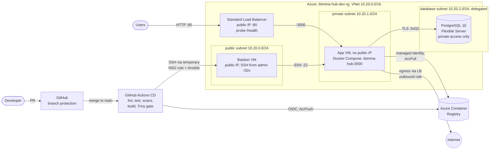

# Ibimina Hub

> **Your savings group's notebook, in your pocket.** Transparent record-keeping for community savings groups in Rwanda.

[](LICENSE)
[](https://github.com/masasu-salomon/ibimina-hub/actions/workflows/ci.yml)
[](https://github.com/masasu-salomon/ibimina-hub/actions/workflows/cd.yml)

**Live application:** <http://ibimina-hub-dev.southafricanorth.cloudapp.azure.com>
· health: <http://ibimina-hub-dev.southafricanorth.cloudapp.azure.com/health>

## African Context

Across Rwanda, millions of people save through **ibimina**: community savings groups
(also called *tontines*, *chamas* or ROSCAs elsewhere in Africa). Members pay a fixed
amount every week or month, and each cycle one member receives the whole pot in turn.

Many groups still keep records in a paper notebook held by the treasurer. This can
cause disputes, lost records, slow meetings and difficulty proving savings history to
a SACCO or microfinance institution. Ibimina Hub provides a shared record of members,
contributions, balances and payouts while supporting Rwandan MTN and Airtel numbers.

## Team Members

- **Masasu Salomon** - Team lead, project setup, groups feature, documentation, CI and board - `s.masasuuwi@alustudent.com`
- **Grevy Karuretwa** - Payout rotation and group summary features - `g.karuretwa@alustudent.com`
- **Phillip Mulindwa** - Member registration, phone validation, contributions and balances - `p.mulindwa@alustudent.com`

## Project Overview

Ibimina Hub is a modular Express API for savings groups. A group leader can create a
group, register members, record fixed contributions and see the current balance.

The API also calculates payout readiness, pays members in join-order rotation and
provides a summary for group meetings. The initial version uses an in-memory store
behind a small collection interface so that persistent storage can be introduced later.

### Target Users

- **Group treasurers and leaders** - register groups and members, record contributions
  and run payouts without manual arithmetic.
- **Group members** - check their contributions, the pot balance and their payout turn.
- **SACCOs and microfinance institutions** *(later)* - review a group's savings history
  when assessing a loan.

### Core Features

- **Savings groups**: Create groups with a fixed contribution amount and weekly or
  monthly frequency.
- **Member registration**: Register members with validated Rwandan MTN or Airtel
  mobile-money numbers; join order determines payout rotation.
- **Contributions and balances**: Record contributions and view total and per-member
  balances.
- **Payout rotation**: Check the next member, verify that the pot is ready and record
  payouts.
- **Group summary**: View members, contribution totals, payouts and pot balance in one
  meeting-friendly response.

## Technology Stack

- **Backend**: Node.js 18+ and Express 4
- **Frontend**: None; this version provides a REST API
- **Database**: In-memory store (`src/common/store.js`), designed for later PostgreSQL support
- **Testing**: Jest and Supertest
- **Linting**: ESLint 9
- **Infrastructure**: Terraform (Azure: VNet, bastion, private VM, Standard Load Balancer,
  PostgreSQL Flexible Server, Azure Container Registry), Ansible
- **Security**: npm audit, Trivy, Checkov, Gitleaks, ansible-lint
- **Other**: Docker, Docker Compose, GitHub Actions (CI + CD), GitHub OIDC to Azure

## Getting Started

### Prerequisites

- [Node.js](https://nodejs.org/) 18 or newer and npm, to run without Docker
- [Docker](https://docs.docker.com/get-docker/) with Docker Compose v2.24 or newer, to run in a
  container (Docker Desktop includes both; check with `docker compose version`)

### Installation

1. Clone the repository:

   ```bash
   git clone https://github.com/masasu-salomon/ibimina-hub.git
   cd ibimina-hub
   ```

2. Install dependencies:

   ```bash
   npm install
   ```

3. Optionally copy the example configuration:

   ```bash
   cp .env.example .env
   ```

4. Run the application:

   ```bash
   npm start
   ```

   The API runs at `http://localhost:3000`.

### Usage

Check the health endpoint:

```bash
curl http://localhost:3000/health
```

Create a group:

```bash
curl -X POST http://localhost:3000/api/groups \
  -H "Content-Type: application/json" \
  -d '{"name":"Twiyubake Nyamirambo","contributionAmount":5000,"frequency":"weekly","location":"Kigali"}'
```

Run the linter and the test suite:

```bash
npm run lint
npm test
npm run test:coverage
```

## Running with Docker Compose

Docker Compose builds the image from the `Dockerfile` and starts the API. No local Node.js
install is needed.

1. Optionally create a `.env` file. Compose loads it when it exists and uses safe defaults
   when it does not:

   ```bash
   cp .env.example .env
   ```

2. Build and start the stack:

   ```bash
   docker compose up --build        # add -d to run in the background
   ```

3. Check that the container is healthy and the API responds:

   ```bash
   docker compose ps                # STATUS shows (healthy)
   curl http://localhost:3000/health
   ```

4. Follow the logs, or stop and remove the stack:

   ```bash
   docker compose logs -f api
   docker compose down
   ```

The stack has one `api` service on the `ibimina-network` network. It restarts unless
stopped, and a health check calls `/health` every 10 seconds. There is no database
container or volume yet, because data lives in memory and resets when the container
restarts. A PostgreSQL service and its volume can join the same network later.

To build and run the image without Compose:

```bash
docker build -t ibimina-hub .
docker run -p 3000:3000 ibimina-hub
```

### Environment Variables

| Variable | Default | Used by | Purpose |
|---|---|---|---|
| `PORT` | `3000` | App | Port the API listens on inside the container |
| `HOST_PORT` | `3000` | Compose | Port on your computer that forwards to the container |
| `NODE_ENV` | `production` in the image | App | Runtime mode |
| `CURRENCY` | `RWF` | App | Currency shown with amounts |

Set `HOST_PORT` in `.env` if port 3000 is already in use on your computer. Never commit
the real `.env` file.

## Architecture



| Piece | Where | Who can reach it |
|---|---|---|
| Load balancer `ibimina-hub-dev-lb` | public IP, DNS `ibimina-hub-dev.southafricanorth.cloudapp.azure.com` | anyone, port 80 only |
| Bastion `ibimina-hub-dev-bastion-vm` | public subnet, own public IP | SSH from `admin_cidrs` (/32s); CD adds its runner's IP for one deploy |
| App VM `ibimina-hub-dev-vm` | private subnet, **no public IP** | port 3000 via the load balancer; SSH only from the bastion subnet |
| PostgreSQL `ibimina-hub-dev-pg` | delegated subnet, private DNS | port 5432 from the app subnet only, TLS required |
| Registry `ibiminahubdev4xjok.azurecr.io` | Azure (Basic) | push: CD identity (AcrPush); pull: app VM identity (AcrPull); admin user off |
| Terraform state | storage account `ibiminatfstate2dl703` | Entra ID only (shared keys off), blob versioning |

No password or cloud key is stored anywhere: GitHub logs in to Azure with OIDC, the VM
pulls images with its managed identity, and the database password is generated by
Terraform and only written to a root-only file on the VM.

## CI/CD Pipeline

```text
feature branch --PR--> CI + Security (required checks) --review + merge--> main
                                                                             |
                                                         cd.yml "Deploy to Production"
  ci (reused ci.yml) + security (reused security.yml)    same checks on the merged code
        |
  build-push    docker build --build-arg GIT_SHA -> Trivy (fails on fixable HIGH/CRITICAL)
        |       -> push ibiminahubdev4xjok.azurecr.io/ibimina-hub:<sha> and :latest
        |                                          terraform-plan  (drift check, read-only)
  deploy        az login (OIDC) -> open bastion NSG for runner IP -> ansible-playbook site.yml
        |       -e app_tag=<sha> -> ACR login, pull, docker compose up -d, wait for /health
        |       (rolls back to the previous image on failure) -> close NSG rule (always)
  smoke test    public URL /health must report "commit": "<sha>"
```

| Workflow | Runs on | Jobs |
|---|---|---|
| [`ci.yml`](.github/workflows/ci.yml) | PRs to `main`/`summative`, pushes to other branches, called by CD | Test (ESLint, Jest + coverage, npm audit), Terraform (fmt, validate both roots), Ansible lint (syntax check + ansible-lint production profile), Docker build + smoke test |
| [`security.yml`](.github/workflows/security.yml) | same, called by CD | Dependency scan, Container scan (Trivy), IaC scan (Checkov: Terraform + Dockerfile), Secret scan (Gitleaks) |
| [`cd.yml`](.github/workflows/cd.yml) | **push to `main` only** (= a merged PR) | CI, Security, Build/scan/push to ACR, Terraform plan, Deploy with Ansible + smoke test |

Branch protection on `main` requires the CI and security checks to pass and one
approving review, with branches up to date and no force pushes, admins included.
CD jobs run in the GitHub `production` environment, which only `main` may use; the Azure
OIDC trust is bound to that environment, so no other branch can get an Azure token.

## Infrastructure and Deployment (operations manual)

| Layer | Tool | Code | Guide |
|---|---|---|---|
| State store + CD identity (once) | Terraform | `terraform/bootstrap` | [terraform/README.md](terraform/README.md) |
| Network, NSGs, bastion, app VM, LB, Postgres, ACR | Terraform modules `network`, `security`, `compute` (x2), `loadbalancer`, `database`, `registry` | `terraform/envs/dev` | [terraform/README.md](terraform/README.md) |
| Harden both VMs, install Docker + Compose, deploy | Ansible roles `common`, `hardening`, `docker`, `app`; dynamic inventory from Terraform outputs | `ansible/` | [ansible/README.md](ansible/README.md) |
| Every release | GitHub Actions | `.github/workflows/cd.yml` | [CI/CD Pipeline](#cicd-pipeline) |

### Set up from zero

You need: Azure CLI (`az login` as an Owner of the subscription), Terraform >= 1.6,
Ansible core 2.16+, Docker, an RSA SSH key pair, and admin rights on the GitHub repo.

```bash
# 1. Bootstrap: remote state storage + GitHub OIDC identity (once per subscription)
cd terraform/bootstrap
terraform init && terraform apply
terraform output                 # client/tenant/subscription IDs, state account, CD principal

# 2. Environment: put the state account in envs/dev/versions.tf (backend block), then
cd ../envs/dev
cp dev.tfvars.example dev.tfvars # your key, teammates' keys, CD key, admin /32s, cd_principal_object_id
terraform init
terraform apply -var-file=dev.tfvars
terraform output app_url

# 3. First deploy from a laptop (later deploys are done by CD)
az acr login --name "$(terraform output -raw acr_name)"
docker buildx build --platform linux/amd64 --build-arg GIT_SHA=$(git rev-parse HEAD) \
  -t "$(terraform output -raw acr_login_server)/ibimina-hub:latest" --push ../../..
cd ../../../ansible
ansible-galaxy collection install -r requirements.yml
ANSIBLE_PRIVATE_KEY_FILE=~/.ssh/<your key> ansible-playbook site.yml

# 4. GitHub: production environment, OIDC IDs, deploy key, tfvars
../scripts/setup-github-cd.sh
```

After step 4, every merge to `main` deploys itself.

### Runbook

| Task | Command |
|---|---|
| Is it up, and which commit is live? | `curl http://ibimina-hub-dev.southafricanorth.cloudapp.azure.com/health` (returns `status`, `version`, `commit`, `uptime`) |
| Load balancer's view of the VM | Azure portal: `ibimina-hub-dev-lb` -> Monitoring -> Metrics -> *Health Probe Status* (100% = VM answering `/health`) |
| SSH to the app VM | `ssh -J azureuser@<bastion_public_ip> azureuser@10.20.1.4` (or `terraform output ssh_command`) |
| Container status and logs | on the app VM: `sudo docker compose -p ibimina-hub ps`, `sudo docker logs -f --tail 100 ibimina-hub` |
| Redeploy one exact build | `ansible-playbook site.yml --tags app -e app_tag=<commit sha>` |
| Roll back | redeploy the previous commit SHA as above; a failed deploy already rolls back by itself |
| Check for drift | the *Terraform plan* job in the latest CD run, or `terraform plan -var-file=dev.tfvars` |
| Re-run config only (should report `changed=0`) | `ansible-playbook site.yml` |
| Tear everything down | `terraform -chdir=terraform/envs/dev destroy -var-file=dev.tfvars` (then `terraform/bootstrap` if wanted) |

Monthly cost while running is roughly USD 45-55 (2 x B2ats_v2 VMs, B1ms PostgreSQL,
Standard LB, ACR Basic, 2 public IPs). Destroy the environment after grading.

## Security Scanning (DevSecOps)

| Scan | Tool | Fails the build on | Where |
|---|---|---|---|
| Dependency | `npm audit --omit=dev` | High or critical vulnerability | CI, Security, CD |
| Container image | Trivy | Fixable high or critical vulnerability | Security (PR) and again on the exact image before push in CD |
| Infrastructure as code | Checkov (Terraform and Dockerfile) | Any failed check not documented as accepted | Security, CD |
| Ansible | ansible-lint (production profile) | Any rule violation (e.g. secrets without `no_log`) | CI, CD |
| Secrets | Gitleaks (full Git history) | Any secret found | Security, CD |

Results are uploaded to the GitHub **Security** tab. Findings, fixes and accepted
risks are documented in [SECURITY.md](SECURITY.md). Accepted Checkov findings are
suppressed in the code next to the resource with a written reason
(`#checkov:skip=<ID>:<why>`), so a reviewer sees the justification in the PR.

## Project Structure

```text
src/
├── app.js                 # Builds the Express app and mounts modules
├── server.js              # Starts the HTTP server
├── config/                # Environment-based configuration
├── common/                # Shared errors, validation and data store
└── modules/
    ├── health/            # Health endpoint
    ├── groups/            # Savings groups
    ├── members/           # Members and payout order
    ├── contributions/     # Contributions and balances
    ├── payouts/           # Payout rotation
    └── summary/           # Group overview
tests/                     # Jest and Supertest tests
```

The application is a modular monolith. Each business area has its own routes and
service layer, allowing a module to become a separate microservice later.

## API Reference

All request and response bodies are JSON. Amounts are whole numbers in RWF.

| Method | Endpoint | Description |
|---|---|---|
| `GET` | `/health` | Service health check |
| `POST` | `/api/groups` | Create a group |
| `GET` | `/api/groups` | List groups |
| `GET` | `/api/groups/:groupId` | Get one group |
| `POST` | `/api/groups/:groupId/members` | Add a member |
| `GET` | `/api/groups/:groupId/members` | List members in payout order |
| `POST` | `/api/groups/:groupId/contributions` | Record a contribution |
| `GET` | `/api/groups/:groupId/contributions` | List contributions |
| `GET` | `/api/groups/:groupId/balance` | Total contributed and each member's total |
| `GET` | `/api/groups/:groupId/payouts/next` | See whose turn is next |
| `POST` | `/api/groups/:groupId/payouts` | Pay the next member |
| `GET` | `/api/groups/:groupId/payouts` | View payout history |
| `GET` | `/api/groups/:groupId/summary` | View the group overview |

## Links

- [Project Board](https://github.com/users/masasu-salomon/projects/1)
- [Team Participation Sheet](https://docs.google.com/spreadsheets/d/1hHUFW2yBKPwx3Qw9GdPJRy3R-AMYLjvlHlPbG7LdXVs/edit?gid=0#gid=0)
- [Repository Issues](https://github.com/masasu-salomon/ibimina-hub/issues)
- [CI workflow](.github/workflows/ci.yml) · [Security workflow](.github/workflows/security.yml) · [CD workflow](.github/workflows/cd.yml) · [SECURITY.md](SECURITY.md) · [CHANGELOG.md](CHANGELOG.md)

## DevOps Practices

- Pull requests and at least one review are required before merging to `main`.
- Required checks: tests, Docker build, Terraform validation, Ansible lint and four security scans.
- Infrastructure is defined in code (`terraform/`, `ansible/`); nothing is set up by hand.
- Releases are automatic: a merge to `main` is the only way to deploy, and every
  image is tagged with its commit SHA so any release can be redeployed or rolled back.
- Branches must be up to date and review conversations must be resolved.
- `.gitignore` excludes secrets, dependencies, build output, logs and IDE files.
- `.env.example` documents configuration without committing real secrets.
- `CODEOWNERS` routes module changes to responsible team members.

## License

[MIT License](LICENSE)
