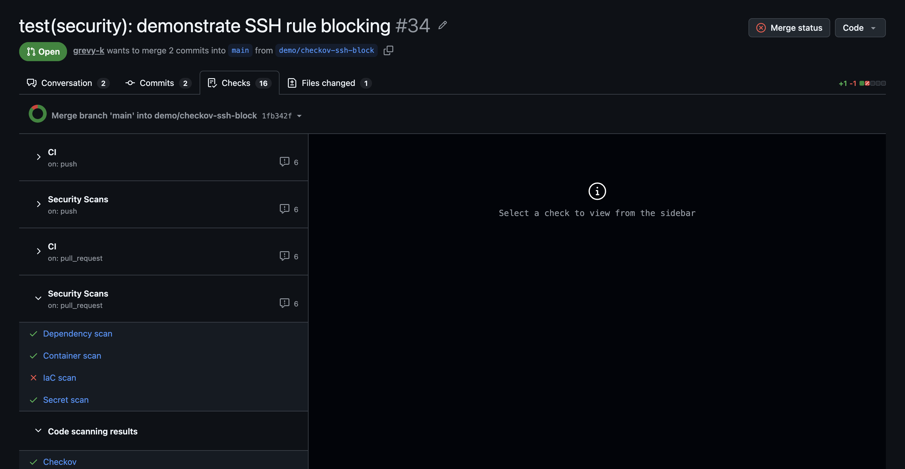
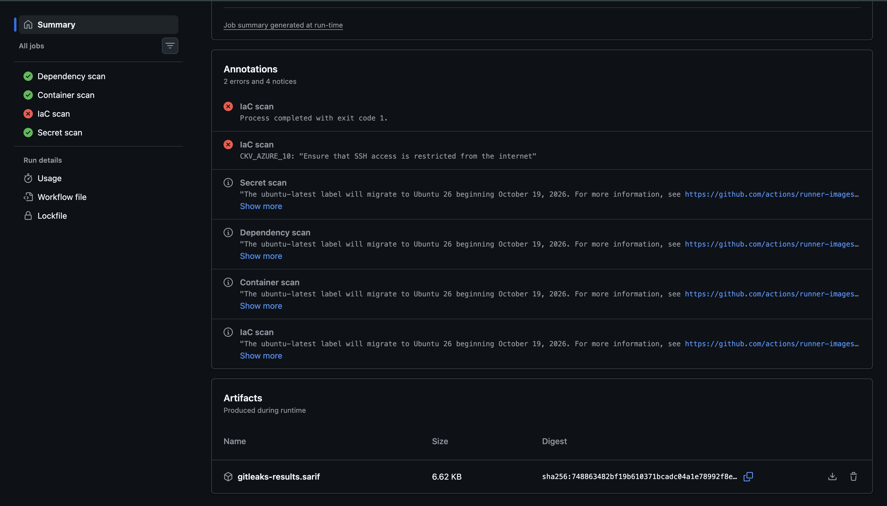

# Security

## Automated checks

The `Security Scans` workflow runs on pushes and pull requests targeting `main`.

| Check | Tool | What it scans | Failure threshold |
|---|---|---|---|
| Dependency scan | `npm audit --omit=dev` | Production Node.js dependencies | High or critical vulnerabilities |
| Container scan | Trivy | Image built from the repository Dockerfile | Fixable high or critical vulnerabilities |
| IaC scan | Checkov | Terraform and Dockerfile | Any failed check unless narrowly accepted and documented |
| Secret scan | Gitleaks | Full Git history | Any detected secret |

Trivy ignores vulnerabilities without an available fix. Exceptions must be specific, explained, and reviewed by the team.

## Latest scan results — 2026-11-10

- Dependency scan (`npm audit --omit=dev`): 0 vulnerabilities found.
- Container scan (Trivy, HIGH and CRITICAL): 0 findings in the latest local scan. The earlier 29 base-image findings were addressed by upgrading Alpine packages and removing bundled package managers from the runtime image.
- IaC scan (Checkov): 25 checks passed, 0 failed, and 1 skipped. `CKV_AZURE_119` was skipped on the VM network interface with a resource-specific reason. The SSH restriction check `CKV_AZURE_10` passed.
- Secret scan (Gitleaks): passed in CI.

## Findings and decisions

| Tool | Finding | Status | Resolution or reason |
|---|---|---|---|
| Checkov | `CKV_AZURE_119` — public IP on VM network interface | Accepted; documented inline | A public IP is required for API and Ansible access. The Checkov skip is scoped to the NIC resource and includes the reason. SSH remains restricted to approved `/32` addresses; `CKV_AZURE_10` passed. |
| Trivy | 29 initial base-image findings: 28 HIGH and 1 CRITICAL | Fixed; latest local scan reports 0 HIGH or CRITICAL findings | Upgraded Alpine packages and removed bundled package managers from the runtime image. The team confirmed the API health check worked after the change. |
| npm audit | Production dependencies | Passed | `npm audit --omit=dev` reported 0 vulnerabilities. |
| Gitleaks | Secrets in Git history | Passed | Gitleaks passed in CI. |

### Other dependency alerts

- **body-parser `GHSA-27r3-jxmh-p828`:** Fixed on `main` in PR #25.
- **Dependabot alert #9 (`deepmerge`):** Accepted by the team as low severity and development-only.

## Accepted risks

- **`CKV_AZURE_119`:** The VM network interface uses a public IP because the API and Ansible need public reachability. The SSH rule is restricted to approved `/32` addresses, and `CKV_AZURE_10` passed. The exception is scoped to the network interface using an inline Checkov skip comment inside its resource block.

## Blocked pull request demonstration

To prove the scans block insecure changes, PR [#34](https://github.com/masasu-salomon/ibimina-hub/pull/34)
changed the SSH rule in `terraform/modules/security/main.tf` to allow any source:

```diff
-  source_address_prefixes     = var.admin_cidrs
+  source_address_prefixes     = ["*"]
```

Result ([IaC scan run](https://github.com/masasu-salomon/ibimina-hub/actions/runs/43030205631/job/130554992464)):

```text
Check: CKV_AZURE_10: "Ensure that SSH access is restricted from the internet"
        FAILED for resource: module.security.azurerm_network_security_rule.ssh_admin
Passed checks: 24, Failed checks: 1, Skipped checks: 1
```

`IaC scan` is a required check on `main`, so GitHub marked the PR as blocked and it
could not be merged. The other checks (tests, Terraform validate, Docker build,
dependency, container and secret scans) passed, which shows the block came from the
security scan alone. The PR was closed without merging.




