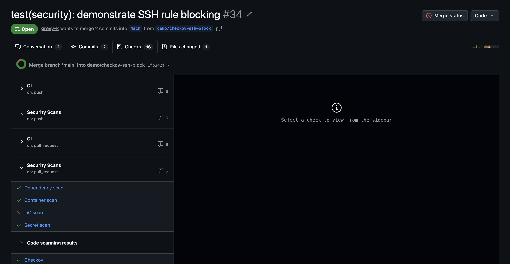
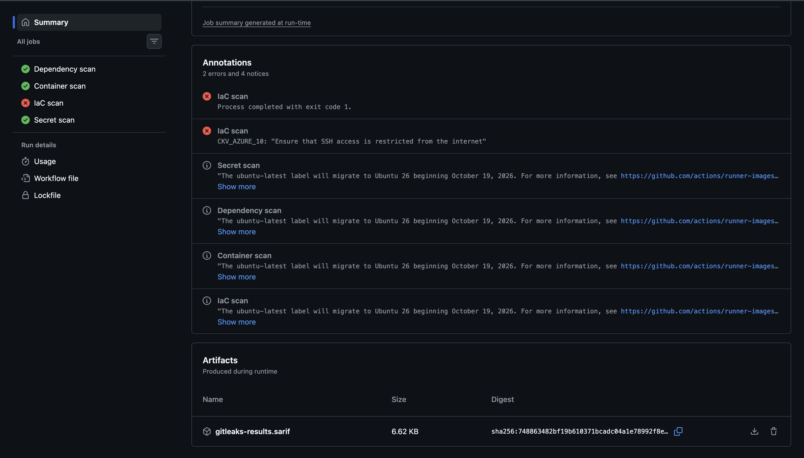

# Security

## Automated checks

The `Security Scans` workflow runs on every pull request (to `main` or `summative`),
on pushes to other branches, and again inside the CD pipeline on every merge to `main`.
CD also scans the exact image it is about to push to ACR with Trivy, and does not push
if that scan fails.

| Check | Tool | What it scans | Failure threshold |
|---|---|---|---|
| Dependency scan | `npm audit --omit=dev` | Production Node.js dependencies | High or critical vulnerabilities |
| Container scan | Trivy | Image built from the repository Dockerfile | Fixable high or critical vulnerabilities |
| IaC scan | Checkov | Terraform and Dockerfile | Any failed check unless narrowly accepted and documented |
| Secret scan | Gitleaks | Full Git history | Any detected secret |
| Ansible lint (CI) | ansible-lint, production profile | Playbook and roles | Any rule violation, e.g. a secret without `no_log` |
| Pre-push image gate (CD) | Trivy | The image tagged with the commit SHA, before `docker push` | Fixable high or critical vulnerabilities |

Trivy ignores vulnerabilities without an available fix. Exceptions must be specific, explained, and reviewed by the team.

## Latest scan results — 2026-11-18 (summative infrastructure)

- IaC scan (Checkov, all of `terraform/`): **74 passed, 0 failed, 19 skipped.** The new
  resources (bastion, private VM, load balancer, PostgreSQL, ACR, state storage) brought
  new findings. Each one was either fixed in the code or suppressed next to the resource
  with a reason (table below).
- Ansible lint (production profile): 0 failures, 0 warnings after fixing 7 findings
  (role variable prefixes, a 184-character line, and a "restart when changed" task that
  was replaced by a checksum label in `compose.yaml`).

### Summative findings and decisions

| Check | Resource | Decision | Why |
|---|---|---|---|
| `CKV2_AZURE_21` blob read logging | state container | **Accepted** (the one failure in the first scan of the new code) | Needs a paid Log Analytics workspace. Access is Entra ID + RBAC only and shows in the activity log. |
| `CKV_AZURE_59`, `CKV2_AZURE_33` public endpoint / private endpoint | state storage account | Accepted | GitHub-hosted runners are outside the VNet. Compensated: shared keys off, `default_to_oauth_authentication`, TLS 1.2, versioning + 30-day soft delete. |
| `CKV2_AZURE_41` SAS expiry | state storage account | Accepted | Shared keys are disabled, so no SAS can be issued at all (an expiry policy is still set). |
| `CKV_AZURE_33`, `CKV_AZURE_206`, `CKV2_AZURE_1` | state storage account | Accepted | Queue logging (no queues), LRS (versioned), Microsoft-managed keys. |
| `CKV_AZURE_136` geo-redundant backup | PostgreSQL | Accepted | Doubles the cost; 7-day point-in-time backup in-region is enough here. |
| `CKV2_AZURE_57` private endpoint | PostgreSQL | Not applicable | Private access through VNet integration (delegated subnet, `public_network_access_enabled = false`) is the alternative. |
| `CKV_AZURE_139` public network access | ACR | Accepted | Runners push from the internet. Admin user and anonymous pull are off; every push/pull needs an identity. |
| `CKV_AZURE_163/164/165/166/167/233/237` | ACR | Accepted | Premium-only features (or paid Defender). Compensated by the Trivy gate in CD before every push. |
| `CKV_AZURE_249` GitHub OIDC trust | CD federated credential (bootstrap) | Not applicable (false positive) | The subject is pinned to `repo:masasu-salomon@180163847/ibimina-hub@1428870229:environment:production`: one repo, one environment, no wildcards. GitHub now signs tokens in this immutable form, and Checkov's repo regex does not accept the `@id` parts. |
| `CKV_AZURE_119` public IP on NIC | bastion + app VM NIC (one module) | Accepted on the bastion; app VM has no public IP | The compute module only attaches a public IP when `public_ip_enabled = true` (bastion only). Checkov cannot see that flag, so the skip sits in the shared module. |

Fixed rather than suppressed while writing the code: the app VM has no public IP; SSH to
it is only from the bastion subnet; PostgreSQL requires TLS and only accepts the app
subnet; the registry admin user is off; state storage disallows shared keys and public
blobs; the CD identity is read-only on the subscription, with write access only to the
state container, ACR push, and the bastion NSG.

## Earlier scan results — 2026-11-10 (Formative 3)

- Dependency scan (`npm audit --omit=dev`): 0 vulnerabilities found.
- Container scan (Trivy, HIGH and CRITICAL): 0 findings in the latest local scan. The earlier 29 base-image findings were addressed by upgrading Alpine packages and removing bundled package managers from the runtime image.
- IaC scan (Checkov): 25 checks passed, 0 failed, and 1 skipped. `CKV_AZURE_119` was skipped on the VM network interface with a resource-specific reason. The SSH restriction check `CKV_AZURE_10` passed.
- Secret scan (Gitleaks): passed in CI.

## Findings and decisions

| Tool | Finding | Status | Resolution or reason |
|---|---|---|---|
| Checkov | `CKV_AZURE_119` — public IP on VM network interface | Accepted; documented inline | A public IP is required for API and Ansible access. The Checkov skip is scoped to the NIC resource and includes the reason. SSH remains restricted to approved `/32` addresses; `CKV_AZURE_10` passed. |
| Trivy | 29 initial base-image findings: 28 HIGH and 1 CRITICAL | Fixed; latest local scan reports 0 HIGH or CRITICAL findings | Upgraded Alpine packages and removed bundled package managers from the runtime image. The team confirmed the API health check worked after the change. |
| npm audit | Production dependencies | Passed | `npm audit --omit=dev` reported 0 vulnerabilities. |
| Gitleaks | Secrets in Git history | Passed | Gitleaks passed in CI. |

### Other dependency alerts

- **body-parser `GHSA-27r3-jxmh-p828`:** Fixed on `main` in PR #25.
- **Dependabot alert #9 (`deepmerge`):** Accepted by the team as low severity and development-only.

## Accepted risks

- **Bastion SSH gate is the NSG, not UFW.** CD opens SSH on the bastion NSG for its runner's
  /32 for the length of one job and always removes it. UFW on the bastion allows SSH from
  any source because runner IPs are unknown in advance. See `ansible/README.md`.
- **`CKV_AZURE_119`:** The VM network interface uses a public IP because the API and Ansible need public reachability. The SSH rule is restricted to approved `/32` addresses, and `CKV_AZURE_10` passed. The exception is scoped to the network interface using an inline Checkov skip comment inside its resource block.

## Blocked pull request demonstration

To prove the scans block insecure changes, PR [#34](https://github.com/masasu-salomon/ibimina-hub/pull/34)
changed the SSH rule in `terraform/modules/security/main.tf` to allow any source:

```diff
-  source_address_prefixes     = var.admin_cidrs
+  source_address_prefixes     = ["*"]
```

Result ([IaC scan run](https://github.com/masasu-salomon/ibimina-hub/actions/runs/43030205631/job/130554992464)):

```text
Check: CKV_AZURE_10: "Ensure that SSH access is restricted from the internet"
        FAILED for resource: module.security.azurerm_network_security_rule.ssh_admin
Passed checks: 24, Failed checks: 1, Skipped checks: 1
```

`IaC scan` is a required check on `main`, so GitHub marked the PR as blocked and it
could not be merged. The other checks (tests, Terraform validate, Docker build,
dependency, container and secret scans) passed, which shows the block came from the
security scan alone. The PR was closed without merging.




